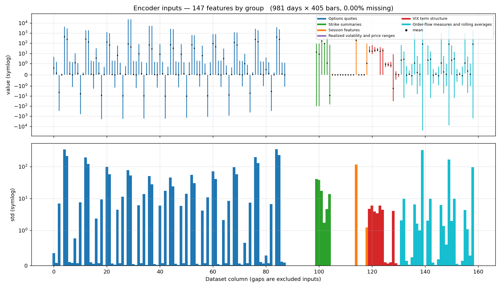

# Original 0DTE options dataset

Minute-level features for SPX same-day-expiry options, the SPX index, VIX and
quote-based order-flow proxies.

## File format

An NPZ archive stores one `float16` array per trading day: **405 minute bars ×
248 features**.

| Key | Contents |
|:--|:--|
| `_manifest` | JSON containing the ordered trading dates |
| `d_YYYY-MM-DD` | Daily `(405, 248)` feature array |

The encoder selects 147 features from columns 0–158 using `ACTIVE_SSL_FEATURES`
in [config.py](../src/potofgold/encoder/config.py). It processes 60-bar windows
at a 30-bar stride, producing 12 windows per complete day.

## Encoder inputs

| Feature group | Count | Contents |
|:--|--:|:--|
| Options quotes | 88 | Eight measures at 11 grid points |
| Strike summaries | 6 | Aggregates across option strikes |
| Session and realized volatility | 14 | SPX returns, ranges, volatility and time remaining |
| VIX term structure | 12 | Indices, futures, ratios and spreads |
| Order-flow proxies | 9 | Quote liquidity, imbalance and related signals |
| Rolling averages | 18 | 3-minute and 15-minute averages of the nine flow measures |

The grid contains puts and calls at 5, 10, 25 and 40 delta, plus three at-the-money
points. Each point supplies midpoint price, implied volatility, theta, gamma,
quoted liquidity, quote imbalance, bid–ask spread and spread change.

The [feature dictionary](../src/potofgold/encoder/variate_names.json) maps column
indices to names and groups. Quote-reliability and retired quote-staleness
channels are excluded from encoder inputs.

## Data card

Feature ranges, means and standard deviations from the original corpus, including
the test period. Colors identify feature groups; axes use symmetric logarithmic
scales.

## Access and reproduction

The original market data is licensed through **QuantConnect** and cannot be
redistributed. **Recomputing the experimental measurements requires the original
processed corpus, corresponding encoder checkpoints and evaluation code.**

[experiment.json](../results/experiment.json) contains the recorded measurements
used to regenerate the report. Synthetic data follows the same input format but
does not reproduce the original results.

See the [transformer guide](../README.md) for data generation, training, embedding
export, evaluation and reporting commands.
